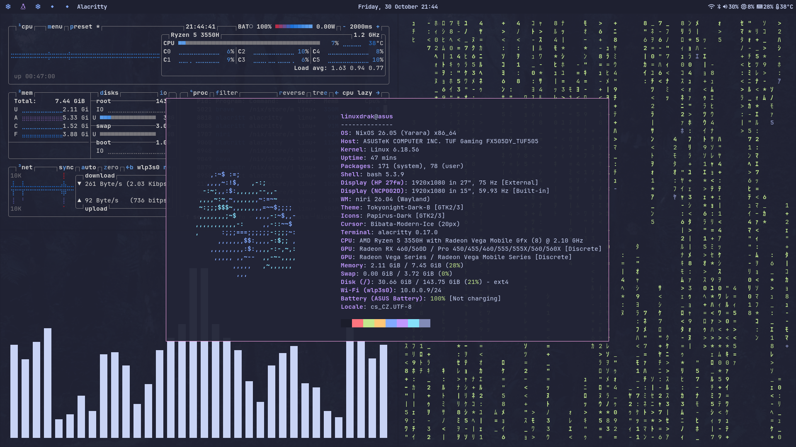
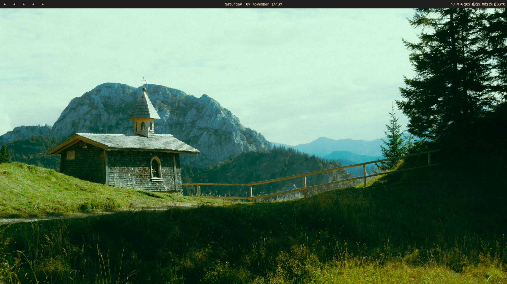
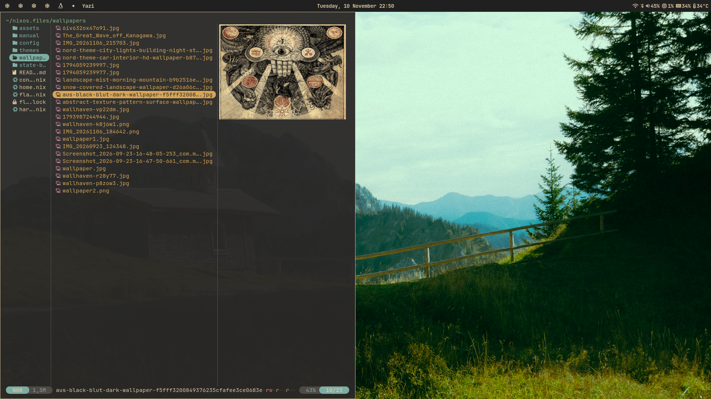
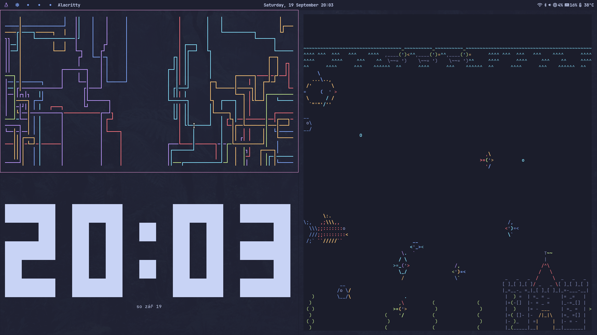
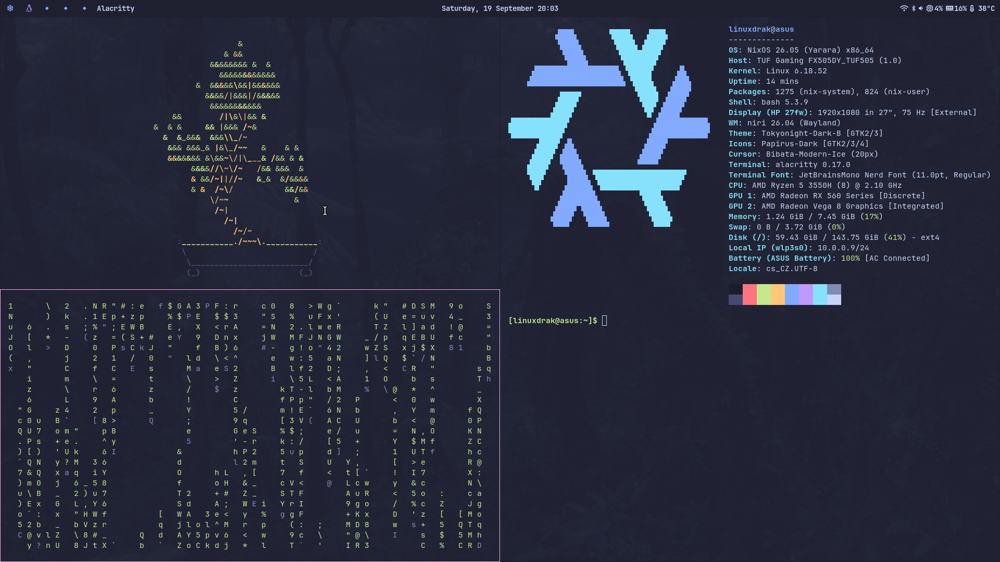
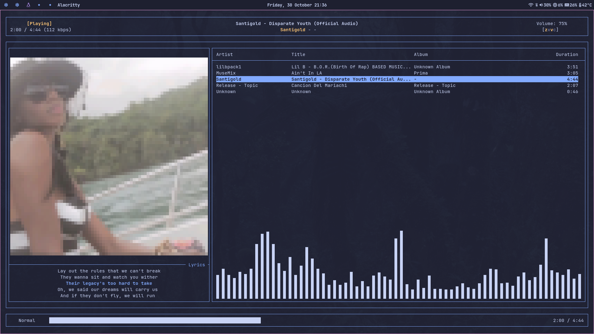
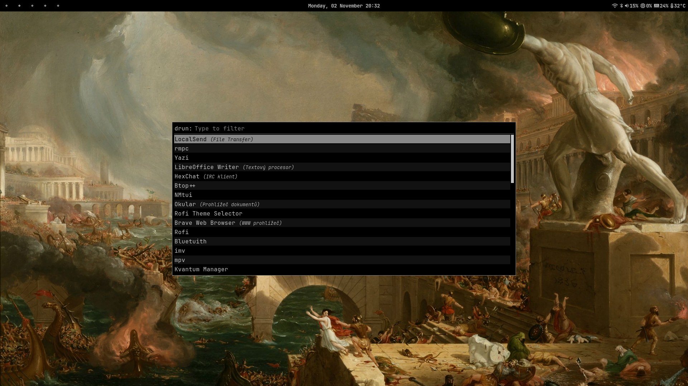
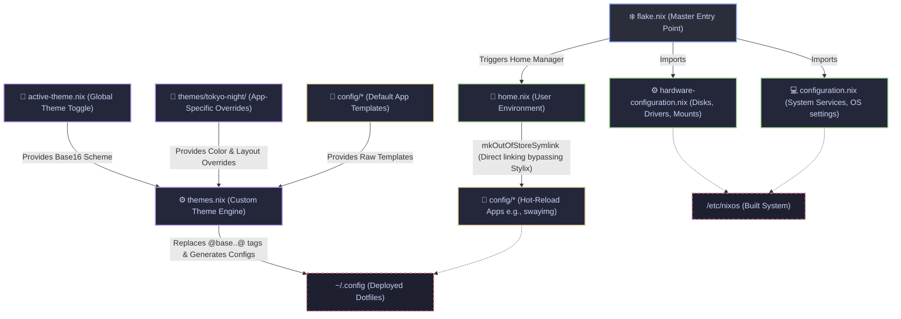

# NixOS Dotfiles & Manual

Welcome to my NixOS configuration repository! This system is managed via Flakes and Home Manager, providing a reproducible and highly customized environment.

This repository contains my personal configurations, themes, scripts, and a complete manual for installing and maintaining the system.

<div align="center">
  
  <br><br>
</div>

## 🌟 System Overview

This configuration is designed to be minimal and free of unnecessary bloat, yet fully configured to be beautiful, comfortable, and ready for daily use right out of the box.

**Key Features:**
- **Core:** Powered by NixOS Flakes and Home Manager.
- **Security:** Built-in, easily toggled code support for **Lanzaboote** (Secure Boot) and **TPM2** (hardware-backed LUKS PIN unlocking).
- **Dotfiles Organization:** All program configurations are neatly stored in `~/nixos.files/config`. The system uses `mkOutOfStoreSymlink` for specific apps, allowing instant hot-reloading without needing a full system rebuild.
- **Ultimate Theming Engine:** Built on top of Stylix, this setup features a highly customizable, custom-coded theme engine. It allows you to seamlessly apply Base16 themes system-wide, while easily creating directory-based exceptions for specific apps (e.g., overriding colors or replacing entire configuration fi>
- **Current Themes:** Includes `tokyo-night`, `black-metal-bathory`, and `gruvbox-material-dark-hard` (adding new ones is as simple as adding a folder, a wallpaper, and a `.yaml` color palette).

**The App Stack:**
Instead of a bloated pre-installed software suite, this system focuses on a curated selection of highly polished tools:
- **WM & UI:** Niri (scrollable tiling window manager), Waybar, and Rofi.
- **Daily Drivers:** Brave Browser (with Origin theme), LibreOffice, and Okular.
- **Media & Utilities:** RMPC (terminal music player), Yazi (file manager), LocalSend (local file sharing), `pass` (password manager with Rofi integration), and `gocryptfs` (encrypted vaults).

> **A Personal Note:**
> I am an everyday user, not a programmer. Because of this, you won't find heavily customized, complex code editors (like Neovim/VSCode IDE setups) in this repository. This system is built purely for daily productivity, media, and a smooth user experience. 
> *A huge shoutout to **@tony-btw**, who guided me to NixOS!*


## 📖 Manual Structure

All documentation is located in the `~/nixos.files/manual` directory. The guides are divided into the following sections and should be read in this order:

- [**1. Graphical Installation (Easier)**](#-1-graphical-installation-easier)
  * Recommended for absolute beginners.
- [**2. Installation (Recommended - Minimal ISO)**](#-2-installation-recommended---minimal-iso)
  * Standard installation method for migrating this config to a new PC.
- [**3. Installation LUKS (Encrypted, RECOMMENDED)**](#-3-installation-luks-encrypted-recommended)
  * The highly recommended installation method for laptops and sensitive data.
- [**4. Lanzaboote (Secure Boot)**](#-4-lanzaboote-secure-boot)
  * Post-installation guide for setting up Secure Boot with your own custom keys.
- [**5. TPM2 (LUKS PIN)**](#-5-tpm2-luks-pin)
  * Final setup guide for unlocking your encrypted drive automatically/with a short PIN.
- [**6. Configuration & Maintenance**](#-6-configuration--maintenance)
  * Guide on managing system settings, modifying themes, editing dotfiles, and updating the OS.
- [**7. Usage & System Manual**](#-7-usage--system-manual)
  * Guide for using the configured system, terminal applications, and a complete list of Niri keyboard shortcuts.

---

<div align="center">
  
  <br><br>
  
  <br><br>
  
  <br><br>
  
  <br><br>
  
  <br><br>
  
</div>

## 🏗️ System Architecture & Data Flow

This diagram illustrates how the NixOS configuration is structured, how the custom theme engine processes dotfiles, and how the final system is built.



## 🚀 1. Graphical Installation (Easier)

> **⚠️ IMPORTANT:** Before starting the installation, it is highly recommended to read the `Configuration, Maintenance` guide to understand how to adjust the system configuration for your specific hardware!

This guide will walk you through the installation of NixOS using the graphical installer.

You can also follow [this video guide (vimjoyer)](https://www.youtube.com/watch?v=AI8EBp0dqVs), or other youtube NixOS [(or Linux in general)](https://www.youtube.com/watch?v=mXyN1aJYefc) graphical installation guides (Calamares) for better understanding the process.

### Part 1: Preparing the Bootable USB Drive

1. **Download NixOS:** Get the **Graphical ISO image** for AMD/Intel (LTS) from [https://nixos.org/download](https://nixos.org/download).
2. **Flash the ISO (Windows):** 
   * Download [Rufus](https://rufus.ie/en/).
   * Write the image to your USB drive. **Important:** Write it in **DD mode** (not ISO mode) and format the drive as **FAT32**.
3. **Flash the ISO (Linux):**
   * Find your USB drive name by running: `lsblk` (look for the whole drive, e.g., `/dev/sdX`, not a partition).
   * Format it using `cfdisk /dev/sdX`.
   * Unmount the drive: `sudo umount /dev/sdX`.
   * Write the image (replace `sdX` with your drive and update the ISO name):

     ```
     sudo dd if=nixos-gnome-xx.xx-x86_64-linux.iso of=/dev/sdX bs=4M status=progress conv=fsync
     ```

### Part 2: System Installation

1. **Prepare the disk:** Create a new empty partition on your target drive (using Disk Management in Windows or `cfdisk` in Linux).
2. **BIOS Settings:** Enter your BIOS/UEFI, **disable Secure Boot**, and set the USB drive as the primary boot device.
3. **Install:** Boot into the NixOS installer and follow the graphical guide (choose either the Gnome or KDE Plasma desktop environment).

### Part 3: Applying the Configuration

Once the base system is installed and you have booted into it, follow these steps to apply this custom configuration:

1. **Copy the repository:** Copy the entire `nixos.files` folder to your home directory: `~/nixos.files/`

2. **Update Hardware Config:** Copy your newly generated hardware configuration file from the system to the repository:

   ```
   cp /etc/nixos/hardware-configuration.nix ~/nixos.files/
   ```

4. **Build the System:** Run the following commands to apply the configuration:

   ```
   nix-shell -p git
   cd ~/nixos.files
   git init
   git add .
   sudo nixos-rebuild switch --flake .#asus
   exit
   ```

### Part 4: Post-Installation Steps

**Restore App States:** Run the `load-state-backup` command in your terminal. This will load the custom configurations for Brave browser, LibreOffice, and Okular.

> **Next Steps:** Proceed to read the **Usage** and **Configuration, Maintenance** guides to learn how to use and maintain your new system. If you run into issues with config changes, refer to the detailed **1. Installation (recommended)** guide for minimal ISO.

## 🚀 2. Installation (Recommended - Minimal ISO)

> **⚠️ IMPORTANT:** Before starting, it is highly recommended to read the `Configuration, Maintenance` guide and adjust the configuration for your specific hardware!

To port your configuration to a new computer using the Minimal ISO, you need to prepare the new disk, generate a new `hardware-configuration.nix`.

Because `home.nix` links some configuration files directly using `mkOutOfStoreSymlink`, we will copy the entire `nixos.files` folder directly to the new disk. This ensures everything works immediately after your first login.

### Step 1: Booting Minimal ISO and Networking

1. **Prepare Files:** Copy your entire `nixos.files` folder (including `.git`, `config`, and `state-backup`) to a second USB drive (or use git clone during the installation).
2. **Boot the Installer:** Boot the new PC from the NixOS Minimal ISO USB drive and switch to the root user:
   ```
   sudo -i
   ```

3. **Connect to the Internet:** If connected via Ethernet, it works automatically. For Wi-Fi, use the Network Manager UI:
   ```
   nmtui
   ```
   *(Verification: Run `ping -c 3 nixos.org` to ensure you are connected and receiving replies).*

### Step 2: Disk Partitioning and Formatting (UEFI)

1. **Find your disk:** Identify your target drive name (e.g., `nvme0n1` or `sda`) by running `lsblk`.
2. **Partition the disk:** Open `cfdisk` for your target drive (replace `nvme0n1` with your actual drive):
   ```
   cfdisk /dev/nvme0n1
   ```

3. **Create partitions:**
   * Select the **gpt** partition table.
   * Delete existing partitions if necessary.
   * Create a **New** partition (1G size), and change its **Type** to `EFI System` (e.g., `nvme0n1p1`).
   * Create a second **New** partition from the remaining space with the default type `Linux filesystem` (e.g., `nvme0n1p2`).
   * Select **Write**, type `yes`, and then **Quit**.

4. **Format and Mount:** Format the partitions and mount them to `/mnt` (adjust partition names accordingly):
   ```
   mkfs.fat -F 32 -n boot /dev/nvme0n1p1
   mkfs.ext4 -L nixos /dev/nvme0n1p2
   mount /dev/disk/by-label/nixos /mnt
   mkdir -p /mnt/boot
   mount -o umask=077 /dev/disk/by-label/boot /mnt/boot
   ```
   *(Verification: Run `lsblk -f`. You should see `/mnt/boot` next to your first partition and `/mnt` next to the second).*

### Step 3: Generating Hardware Config & Transferring Files (Use git clone or follow the manual (USB guide))

1. **Scan Hardware:** Let the installer generate the hardware configuration for the new PC:
   ```
   nixos-generate-config --root /mnt
   ```

2. **Mount the second USB drive:** Find your second USB drive (the one with your files) using `lsblk`. Let's assume it is `sdc1`. Create a temporary folder and mount it:
   ```
   mkdir -p /mnt/usb
   mount /dev/sdc1 /mnt/usb
   ```

3. **Copy the configuration:** Create the target home directory for your user and copy the repository:
   ```
   mkdir -p /mnt/home/linuxdrak/nixos.files/
   cp -a /mnt/usb/nixos.files/. /mnt/home/linuxdrak/nixos.files/
   umount /mnt/usb
   ```

4. **Replace Hardware Config:** Overwrite your old hardware config with the newly generated one from the installer:
   ```
   cp /mnt/etc/nixos/hardware-configuration.nix /mnt/home/linuxdrak/nixos.files/
   ```
   *(Verification: Run `ls -la /mnt/home/linuxdrak/nixos.files` and ensure all files, including the newly overwritten hardware config, are present).*

### Step 4: Committing Changes and Installing

1. **Git Add:** Because Flakes only read files tracked by Git, you must add the modified and new files (initiate if it is not):
   ```
   nix-shell -p git 
   git -C /mnt/home/linuxdrak/nixos.files init
   git -C /mnt/home/linuxdrak/nixos.files add .
   ```

2. **Install NixOS:** Run the installation, specifying your flake profile:
   ```
   nixos-install --flake /mnt/home/linuxdrak/nixos.files#asus
   ```

   *(Verification: At the very end of the installation, it will prompt you to set a `root` password. The process should finish with "Installation finished. No error reported.").*

### Step 5: Setting User Password and Fixing Permissions

1. **Enter the installed system:** Because the home folder was created during installation by the root user, you must transfer ownership to your user (`linuxdrak`) and set your login password. Enter the new system via chroot:
   ```
   nixos-enter --root /mnt
   ```

2. **Set password and ownership:** Run these commands inside the new system:
   ```
   passwd linuxdrak
   chown -R linuxdrak:users /home/linuxdrak
   exit
   ```

3. **Reboot:** Unplug the installation USB drives and restart the computer:
   ```
   reboot
   ```

> **After Reboot:** You will be greeted by the `tuigreet` login screen. After logging in, the Niri environment will launch automatically. Open a terminal and run your `load-state-backup` alias to instantly restore your Brave bookmarks, Okular settings, and LibreOffice UI colors!

## 🚀 3. Installation LUKS (Encrypted, RECOMMENDED)

> **⚠️ IMPORTANT:** Before starting, it is highly recommended to read the `Configuration, Maintenance` and `1. Installation (Recommended)` guides first!

To enable full disk encryption (LUKS), the installation process only changes during the disk partitioning and formatting phase. The boot partition (`/boot`) remains unencrypted so the `systemd-boot` bootloader can load the system kernel, while the main system partition is locked inside an encrypted container using `cryptsetup`.

A major advantage of NixOS is that the `nixos-generate-config` command automatically detects the mounted encrypted partition and writes the necessary unlocking rules directly into your new `hardware-configuration.nix` file.

When creating the encrypted partition with `cryptsetup luksFormat`, the program will ask you to confirm by typing `YES` in **uppercase** letters (lowercase `yes` will fail). Keep in mind that the Minimal ISO uses a US (QWERTY) keyboard layout by default.

### Step 1: Booting Minimal ISO and Networking

1. **Boot the Installer:** Boot the new PC from the NixOS Minimal ISO USB drive, have your second USB drive (with `nixos.files`) ready, and switch to the root user:

   ```
   sudo -i
   
   ```

2. **Connect to the Internet:** If you are not connected via Ethernet, connect to Wi-Fi using the Network Manager UI:

   ```
   nmtui
   
   ```

   *(Verification: Run `ping -c 3 nixos.org` to ensure you are connected and receiving replies).*

### Step 2: Disk Partitioning (cfdisk)

1. **Find your disk:** Identify your target drive name (e.g., `nvme0n1` or `sda`) by running `lsblk`.

2. **Partition the disk:** Open `cfdisk` for your target drive (replace `nvme0n1` with your actual drive):

   ```
   cfdisk /dev/nvme0n1
   
   ```

3. **Create partitions:**

   * Select the **gpt** partition table.

   * Create a **New** partition (1G size), and change its **Type** to `EFI System` (e.g., `nvme0n1p1`).

   * Create a second **New** partition from the remaining free space with the default type `Linux filesystem` (e.g., `nvme0n1p2`).

   * Select **Write**, type `yes`, and then **Quit**.

   *(Verification: Run `lsblk`. You should see two new partitions under your drive).*

### Step 3: LUKS Encryption, Formatting, and Mounting

1. **Format the boot partition:** First, format the unencrypted EFI boot partition:

   ```
   mkfs.fat -F 32 -n boot /dev/nvme0n1p1
   
   ```

2. **Create the LUKS container:** Encrypt the second partition. It will prompt you to type `YES` and then ask for your new encryption password (make it strong; you can later set up TPM2 to avoid typing it manually every time):

   ```
   cryptsetup luksFormat /dev/nvme0n1p2
   
   ```

3. **Open the encrypted partition:** Unlock it and map it as `cryptroot` (you will need to enter your password again):

   ```
   cryptsetup open /dev/nvme0n1p2 cryptroot
   
   ```

4. **Format and Mount:** Format the *unlocked* virtual partition (`/dev/mapper/cryptroot`) to ext4, and mount everything to `/mnt`:

   ```
   mkfs.ext4 -L nixos /dev/mapper/cryptroot
   mount /dev/mapper/cryptroot /mnt
   mkdir -p /mnt/boot
   mount -o umask=077 /dev/disk/by-label/boot /mnt/boot
   
   ```

   *(Verification: Run `lsblk -f`. You should see `cryptroot` (type crypt) mounted to `/mnt`, and your first partition mounted to `/mnt/boot`).*

### Step 4: Generating LUKS Config & Transferring Files (Use git clone or follow the manual (USB guide))

1. **Scan Hardware:** Let NixOS generate the hardware configuration. It will automatically detect `cryptroot` and write the LUKS unlocking rules:

   ```
   nixos-generate-config --root /mnt
   
   ```

2. **Mount the second USB drive:** Find your second USB drive using `lsblk` (e.g., `sdc1`). Create a temporary folder and mount it:

   ```
   mkdir -p /mnt/usb
   mount /dev/sdc1 /mnt/usb
   
   ```

3. **Copy the configuration:** Create the target home directory for your user and copy the repository:

   ```
   mkdir -p /mnt/home/linuxdrak/nixos.files/
   cp -a /mnt/usb/nixos.files/. /mnt/home/linuxdrak/nixos.files/
   umount /mnt/usb
   
   ```

4. **Replace Hardware Config:** Overwrite your old hardware config with the newly generated one:

   ```
   cp /mnt/etc/nixos/hardware-configuration.nix /mnt/home/linuxdrak/nixos.files/
   
   ```

   *(Verification: Run `grep -i luks /mnt/home/linuxdrak/nixos.files/hardware-configuration.nix`. It should output a line starting with `boot.initrd.luks.devices."cryptroot".device = ...`, confirming NixOS knows about the encryption).*

### Step 5: System Installation and User Setup

1. **Git Add:** Add the modified and new files to Git (initiate if it is not):

   ```
   nix-shell -p git 
   git -C /mnt/home/linuxdrak/nixos.files init
   git -C /mnt/home/linuxdrak/nixos.files add .
   
   ```

2. **Install NixOS:** Run the installation:

   ```
   nixos-install --flake /mnt/home/linuxdrak/nixos.files#asus
   
   ```

3. **Set user password and permissions:** After setting the root password at the end of the installation, enter the new system via chroot, set the password for `linuxdrak`, and fix folder ownership:

   ```
   nixos-enter --root /mnt
   passwd linuxdrak
   chown -R linuxdrak:users /home/linuxdrak
   exit
   
   ```

4. **Reboot:**

   ```
   reboot
   
   ```

> **After Reboot:** Upon restarting, the system will first prompt you for the disk encryption password (`Passphrase for ...`). Once unlocked, the `tuigreet` login screen will appear. After logging in, Niri will launch, and you can open a terminal to run `load-state-backup` to restore your app settings.

## 🔒 4. Lanzaboote (Secure Boot)

Enabling Lanzaboote *after* the initial system installation is the officially recommended approach. You first install the system using the standard `systemd-boot` (as described in the previous guides), boot into your working NixOS, generate encryption keys for Secure Boot, and only then switch your configuration to Lanzaboote. Full disk encryption (LUKS) works flawlessly with this method and requires no extra steps.

> **⚠️ CRITICAL: Dual-booting with Windows 11**
> If you are dual-booting with Windows 11, you must pay attention to two specific things so neither system breaks:
> 
> 1. **Windows Bootloader Support (`--microsoft`):** The Windows 11 bootloader is signed by Microsoft. When enrolling your custom keys into your motherboard, you MUST use the `--microsoft` flag. This appends Microsoft's certificates to your keys. Without it, your BIOS will refuse to boot Windows 11.
> 2. **Beware of BitLocker:** To enroll custom keys, you must delete the default factory keys in your BIOS (entering "Setup Mode"). If your Windows 11 partition has BitLocker encryption enabled, this hardware change will cause Windows to ask for your 48-digit recovery key on the next boot. **Before starting**, boot into Windows and temporarily suspend BitLocker protection, or ensure you have your recovery key printed/saved elsewhere.

### Step 1: Generating Custom Secure Boot Keys

1. **Open a terminal:** Once your new system is installed and you have booted into it for the first time (with Secure Boot still disabled in your BIOS), open your terminal. Since `sbctl` is already included in your `environment.systemPackages`, it is ready to use.

2. **Create the keys:** Generate your custom signing keys:
   ```
   sudo sbctl create-keys
   
   ```

   *(Verification: The command will confirm the keys were created in `/var/lib/sbctl`. Running `sudo sbctl status` should show `Installed: ✓ sbctl is installed`).*

### Step 2: Activating Lanzaboote in Configuration

Now, revert your configuration to the state you use on your main computer:

1. **Edit `flake.nix`:** Open `~/nixos.files/flake.nix` and uncomment the Lanzaboote module. The list should look like this:
   ```
     modules = [
       ./hardware-configuration.nix
       ./configuration.nix
       lanzaboote.nixosModules.lanzaboote
       home-manager.nixosModules.home-manager
   
   ```

2. **Edit `configuration.nix`:** Open `~/nixos.files/configuration.nix`. Force-disable `systemd-boot` again and uncomment the `boot.lanzaboote` block:
   ```
     boot.loader.systemd-boot.enable = pkgs.lib.mkForce false;
     boot.lanzaboote = {
       enable = true;
       pkiBundle = "/var/lib/sbctl";
     };
   
   ```

3. **Rebuild the system:** Save both files and rebuild the system using your custom alias:
   ```
   rebuild
   
   ```

   *(Verification: Run `sudo sbctl verify`. All NixOS boot files (`nixos-generation-*.efi`) will have a green checkmark `✓ ... is signed`. The Windows file `bootmgfw.efi` will temporarily show an `✗`, which we will fix in Step 4).*

### Step 3: Switching BIOS to Setup Mode

For your motherboard to accept your new keys from NixOS, Secure Boot must be put into "Setup Mode".

1. **Enter BIOS/UEFI:** Restart your computer and press the BIOS key (usually F2, Del, or F12).

2. **Clear Keys:** Navigate to the **Security** or **Boot -> Secure Boot** section. Change the Secure Boot mode to **Custom** and select the option to **Clear Secure Boot Keys** / **Erase all Secure Boot variables** (sometimes called **Reset to Setup Mode**).

3. **Save and Reboot:** Save changes (usually F10) and let the computer boot back into NixOS (unlocking your LUKS drive if prompted).

   *(Verification: After logging into NixOS, run `sudo sbctl status`. The `Setup Mode` entry must have a green checkmark `✓ Enabled`).*

### Step 4: Enrolling Keys into the Motherboard

Now we will write your generated keys directly into the motherboard's UEFI chip, alongside the Microsoft certificates (which are necessary for booting Windows 11 and loading GPU firmwares).

1. **Enroll the keys:** Run the following command:
   ```
   sudo sbctl enroll-keys --microsoft
   
   ```

   *(Verification: The terminal will print `Enrolled keys to the EFI variables!`. If you run `sudo sbctl status` again, `Setup Mode` will now show `✗ Disabled`, meaning your motherboard is successfully locked with your custom keys).*

### Step 5: Enabling Secure Boot and Final Test

1. **Enable Secure Boot:** Restart your computer. On most motherboards, enrolling keys automatically activates Secure Boot. If it doesn't, enter your BIOS one last time, change **Secure Boot** to **Enabled**, save, and reboot.

2. **Boot the system:** In the boot menu (now managed by Lanzaboote), you will see your NixOS generations and the Windows Boot Manager. Select NixOS, unlock your LUKS drive, and log in.

   *(Verification: Open a terminal and run `sudo sbctl status` or `bootctl status`. The `Secure Boot` entry will now show a green checkmark `✓ Enabled`).*

### Step 6: Securing the BIOS

1. **Set a BIOS password:** To prevent anyone from tampering with your Secure Boot keys or disabling Secure Boot, restart your PC, enter the BIOS, and set an **Administrator/Supervisor Password**. Make sure you remember it!

## 🔑 5. TPM2 (LUKS PIN)

Setting up a TPM2 PIN is the very last step of the installation process. You must do this **only after completing Step 5 of the Lanzaboote guide**, when running `sudo sbctl status` shows a green checkmark next to `Secure Boot: ✓ Enabled`.

The TPM2 chip takes a cryptographic "snapshot" of your current BIOS and Secure Boot state. If you were to set this up earlier, enabling Secure Boot later would change the system state, the TPM chip would think the computer was tampered with, and your PIN would not work.

### Step 1: Modifying configuration.nix

1. **Edit the configuration:** Open `~/nixos.files/configuration.nix` and add these three lines. They will merge with your `cryptroot` configuration and enable early TPM2 support during boot:

   ```
   boot.initrd.systemd.enable = true;
   security.tpm2.enable = true;
   boot.initrd.luks.devices."cryptroot".crypttabExtraOpts = [ "tpm2-device=auto" ];
   
   ```

2. **Rebuild the system:** Save the file and apply the changes:

   ```
   rebuild
   
   ```

### Step 2: Enrolling the PIN into the TPM2 Chip

Assuming your encrypted LUKS container is on `/dev/nvme0n1p2` (as per the installation guide), run the following command to bind the encryption key to the TPM2 chip:

1. **Run the enrollment command:**

   ```
   sudo systemd-cryptenroll --tpm2-device=auto --tpm2-pcrs=0+7 --tpm2-with-pin=yes /dev/nvme0n1p2
   
   ```

2. **Follow the prompts:**
   * **`Please enter current passphrase for disk...`**: Type the long, secure encryption password you created during the LUKS installation. This proves you own the drive.
   * **`Please enter TPM2 PIN` & `(repeat)`**: Type your new short PIN (can contain letters and numbers) and press Enter.

> **⚠️ CRITICAL: Keyboard Layout Warning**
> During boot (before Niri loads), the keyboard uses a default US (QWERTY) layout where the top row types numbers (`1234567890`) directly. However, if you are currently running a Czech system, the top row types `+ěščřžýáíé` unless you hold Shift. 
> To avoid locking yourself out because of mismatched characters, **use the dedicated Numpad** to enter your PIN, or **hold Shift** while typing numbers on the top row during this enrollment step.

3. **Verify enrollment:** Check that the TPM was added successfully:

   ```
   sudo cryptsetup luksDump /dev/nvme0n1p2
   
   ```

   *(Verification: Look at the end of the output. In the `Tokens:` section, you should see a new entry `0: systemd-tpm2`. In the `Keyslots:` section, you will see two occupied slots—slot 0 is your original long LUKS password, and slot 1 is the new TPM2 key).*

### How the Boot Process Works in Practice

Once you restart your laptop, the boot sequence will look exactly like this:

1. **Power On & Secure Boot Check (0–2 seconds):** You press the power button. The motherboard silently verifies that Lanzaboote is signed with your custom key.
2. **Boot Menu:** The `systemd-boot` menu appears instantly (because the `/boot` partition is unencrypted). You can choose NixOS or Windows Boot Manager.
   * *If you choose Windows 11:* Windows boots immediately. It does not ask for a LUKS PIN because Windows does not interact with the Linux partition.
   * *If you choose NixOS:* Lanzaboote verifies the signature of the NixOS kernel and loads it.
3. **TPM2 PIN Prompt:** The screen goes black, and the system asks to unlock the drive: `Please enter TPM2 PIN:`. You type your short PIN and press Enter. The TPM2 chip verifies the PIN, confirms that Secure Boot and the BIOS have not been tampered with, and instantly unlocks the `cryptroot` partition.
4. **System Login:** Within 2–3 seconds, the `tuigreet` screen appears. You enter your standard user password (for the `linuxdrak` account) and enter the Niri desktop environment.

### Emergency Scenarios (The Failsafes)

* **You type the wrong PIN:** The system will let you try again. However, if a thief tries to guess the PIN repeatedly, the TPM2 chip will hardware-lock itself after a few failed attempts (Dictionary Attack Lockout) and refuse further guesses.
* **You update the BIOS or disable Secure Boot:** Because we bound the key to PCR 0 (BIOS version) and PCR 7 (Secure Boot state), the TPM2 chip will detect the change and refuse to release the encryption key. **You will not lose data!** The system will gracefully fall back and ask for your original, long LUKS passphrase from the installation. Once you boot into the system, you can reset the TPM slot and enroll a new PIN:

  ```
  sudo systemd-cryptenroll --wipe-slot=tpm2 /dev/nvme0n1p2
  
  ```
  *(After wiping it, simply repeat Step 2 to register the new BIOS state).*

## 🔧 6. Configuration & Maintenance

> **⚠️ IMPORTANT:** It is highly recommended to configure your programs and system preferences in the `.nix` files *before* installation (especially on older hardware).

All information regarding the system build, settings, downloaded programs, and themes is managed in `~/nixos.files`. NixOS will build itself exactly as described in these files (usually) without needing any post-installation tinkering.

### 1. Hardware-Specific Settings (Non-ASUS laptops & PCs)

If your computer is **not** an ASUS laptop, you must disable the ASUS-specific services to prevent errors:

1. **In `configuration.nix`:** Comment out the ASUS daemon:

   ```
   # services.asusd.enable = true;  #asuss
   
   ```

2.  * `Graphics Drivers` The default configuration is set for AMD. If you are using a different graphics card (Intel or NVIDIA), make sure to change `services.xserver.videoDrivers = [ "amdgpu" ];` in `configuration.nix` to match your hardware.

*(Note: If you have a different graphics card, follow [this YouTube guide](https://www.youtube.com/watch?v=qlfm3MEbqYA) or find instructions for your specific GPU on the official wiki: [NVIDIA](https://wiki.nixos.org/wiki/NVIDIA), [AMD](https://wiki.nixos.org/wiki/AMD_GPU), [Intel](https://wiki.nixos.org/wiki/Intel_Graphics), or the [nixos-hardware repository](https://github.com/NixOS/nixos-hardware)).*

3. **In `home.nix`:** Comment out the ROG Control Center:

   ```
   # rog-control-center = {
   #   name = "ROG Control Center";
   #   noDisplay = true;
   # };
   
   ```

4. **In `config/waybar/config.jsonc` (Temperature module):**
   *Uncomment* the standard power profiles commands:

   ```
   "on-click": "footclient --hold -a PowerProfilesCtl -T PowerProfilesCtl powerprofilesctl get",
   "on-click-right": "~/nixos.files/config/waybar/powerprofilesctl.sh",
   
   ```

   *Comment out* the ASUS-specific commands:

   ```
   // "on-click": "footclient --hold -a AsusCtl -T AsusCtl asusctl profile get", //asuss
   // "on-click-right": "asusctl profile next", //asuss
   
   ```

*(Note: If you have an ASUS laptop but experience issues with `asusctl`, uncomment the line `#"d /etc/asusd 0755 root root -"` in `systemd.tmpfiles.rules` inside `configuration.nix`).*

### 2. Monitors & Window Rules

**Setting up Displays:**
Find your monitor names by running `niri msg outputs`. Then, adjust or comment out the monitor block in `config/niri/config.kdl`. For example, to turn off the laptop screen and use an external monitor:

```
//monitorr
output "eDP-1" {
    off
}
//monitorr
output "HDMI-A-1" {
   mode "1920x1080"
   scale 1 position x=0 y=0
}

```

**Adjusting `rmpc` Window Size:**
The music player's size depends on your monitor resolution, Niri borders, and Waybar size. Find the current window size by running `niri msg windows`, then adjust the values in `config/niri/config.kdl`:

```
//rmpcc
window-rule {
    match app-id="rmpc"
    open-floating false
    min-width 1918
    max-width 1918
    min-height 1046
    max-height 1046
}

```

### 3. System & UI Preferences

* **Auto-Login:** To enable automatic login, uncomment the `initial_session` block in `configuration.nix`:
  ```
  initial_session = {
      command = "niri-session";
      user = "linuxdrak";
  };
  
  ```

* **Hostname:** Change your PC name in `configuration.nix`:
  ```
  networking.hostName = "your_new_name";
  
  ```

* **Language & Local Time:** Find the correct time zone for your country (see the [Wikipedia list of tz database time zones](https://en.wikipedia.org/wiki/List_of_tz_database_time_zones)) and your locale code (e.g., `en_US.UTF-8`). Update the following files to match your region:

  In `configuration.nix`:

  ```
  time.timeZone = "Europe/Prague";
  i18n.defaultLocale = "cs_CZ.UTF-8"; 
  i18n.supportedLocales = [ "cs_CZ.UTF-8/UTF-8" "en_US.UTF-8/UTF-8" ];
  i18n.extraLocaleSettings = { LC_TIME = "en_US.UTF-8"; };
  
  ```

  In `config/niri/config.kdl` (to adjust the keyboard layout):

  ```
  keyboard { xkb { layout "cz,us" options "grp:alt_shift_toggle" } }
  
  ```

* **Display Brightness (Fn keys):**
  Uncomment `brightnessctl` in `configuration.nix`.
  Then, uncomment the keybindings in `config/niri/config.kdl`:
  ```
  //XF86MonBrightnessUp { spawn "brightnessctl" "set" "5%+"; }
  //XF86MonBrightnessDown { spawn "brightnessctl" "set" "5%-"; }
  
  ```

* **Waybar Weather:**
  In `config/waybar/config.jsonc`:
  1. Add `"custom/weather"` to the `"modules-center"` array (do not forget the formating (comma after: "clock",).
  2. Add a comma at the end of your clock format: `"format": "{:%A, %d %B %H:%M},",`.
  3. Uncomment the `"custom/weather"` block at the bottom of the file (and change the city name in the `wttr.in` URL if needed (do it also in config/waybar/weather.sh and in home.nix (in shell aliases))).

* **Extra Packages:**
  Uncomment desired tools in `configuration.nix` (e.g., `mapscii`, `sherlock`, `unstable.proton-vpn`, `unstable.tor-browser`, or chat apps like `simplex-chat-desktop`).

### 4. App Configurations (Paths & Shortcuts)

* **Music Directory (MPD, yt-dlp, rmpc):**
  If you store music somewhere other than `~/.Music`, update these paths:
  1. `configuration.nix` (services.mpd): `musicDirectory = "${config.home.homeDirectory}/.Music";`
  2. `configuration.nix` (programs.bash / yt-dlp): `-o '~/.Music/%(title)s.%(ext)s'`
  3. `config/rmpc/config.ron`: `lyrics_dir: Some("~/.Music"),`

* **Yazi Flash Drive Shortcut:**
  Open `config/yazi/keymap.toml` and change the path to match your USB drive's name:
  ```
  [[mgr.prepend_keymap]]
  on   = [ "g", "f" ]
  run  = 'cd "/run/media/linuxdrak/16 GB DRIVE"' 
  desc = "Go to flash drive"
  
  ```

### 5. OPSEC (Disabling Mic, Camera, and Location)

If you want strict privacy, keep these uncommented/applied:

* **Location:** `services.geoclue2.enable = false;` (in `configuration.nix`).
* **Camera (Software):** `boot.blacklistedKernelModules = [ "uvcvideo" ];` (in `configuration.nix`).
* **Camera (Hardware):** Disable the camera directly in your BIOS (do this before installation).
* **Microphone:** Run `pamixer --default-source -m` in the terminal after installation to mute it by default.

---

### 6. Theme Management Engine

This system uses a highly modular theme engine. It processes themes dynamically and allows for extensive application-level overrides.

**1. Changing the Active Theme**
The entire system is controlled by one central file: `~/nixos.files/themes/active-theme.nix`.
To change the system's look (e.g., from `gruvbox-material-dark-hard` to `tokyo-night`), edit the path:
```
path = ./tokyo-night/theme.yaml;

```
Run your `rebuild` command. The wallpaper, UI, and apps will automatically inherit the new theme. The `name` variable automatically extracts the theme name from the folder. *(Note: Changes apply after logging out of Niri or rebooting).*

**2. Theme Exceptions**
Some themes might require special handling (like custom KDE icons or specific Brave browser flags). You define these as lists in `active-theme.nix`:
```
isSpecialKde = builtins.elem name [ "tokyo-night" "nord" "dracula" ];

```
When the `dracula` theme is active, `isSpecialKde` evaluates to `true`, and your main Nix config can react to it (e.g., disabling Stylix for KDE).

**3. Creating a New Theme**
1. Create a new folder in `~/nixos.files/themes/` (e.g., `dracula`).
2. Add a wallpaper named `wallpaper.jpg` inside this folder.
3. Create a `theme.yaml` file defining the Base16 color palette (from `base00` to `base0F` in hex format without the `#`).

**4. Overriding Colors for a Specific App**
If the global `theme.yaml` colors don't fit a specific app (e.g., you want a transparent Waybar background exclusively in `tokyo-night`):
1. Create an app folder inside the theme directory (e.g., `themes/tokyo-night/waybar/`).
2. Create a `theme.nix` file inside.
3. Define only the Base16 colors you want to override:
```
{
  # Makes base00 transparent for Waybar in this theme only
  base00 = "00000000"; 
}

```

**5. Overriding an Entire Config File per Theme**
The engine looks for config files in the active theme folder first. If none exist, it uses the defaults.
If you want a completely different layout for `rofi` exclusively for `tokyo-night`:
1. Create `themes/tokyo-night/rofi/config.rasi`.
2. Write your completely custom layout here.
3. You can still use `@base00@` tags, hardcode colors, or use a `theme.nix` override in the same folder.
During a rebuild, the engine will ignore the default Rofi config, take this custom one, colorize it, and deploy it.

**6. Adding a New Program to the Theme Engine**
If you install a new program that uses text-based configs, the engine can inject colors into it. Edit `~/nixos.files/themes/themes.nix`:
1. Load colors for the app:
   ```
   myprogram = loadColors (themeDir + "/myprogram/theme.nix");
   
   ```
2. Call the `mergeFiles` function at the bottom:
   ```
   // (mergeFiles "myprogram" "#" [ "config.txt" ])
   
   ```
   *(Specify the app name, the hex prefix like `#` or `""`, and the target configuration file). The system will now scan `config/myprogram/config.txt` for `@base...@` tags and replace them.*

---

### 7. Hot-Reloading Configs (Symlinks)

If you have a program that you do **not** want to be styled by Stylix or the theme engine, but you want to edit its config and see changes instantly without running a rebuild, use symlinks.

1. Do not add the program to `themes.nix`.
2. Create its folder and config file in `~/nixos.files/config/myprogram/`. (Do *not* create a `theme.nix` file here).
3. Open `~/nixos.files/home.nix` and add it to the `configs` variable:
   ```
   configs = { 
       #program = "program"; 
       swayimg = "swayimg"; 
       myprogram = "myprogram"; # <--- ADD NEW PROGRAM HERE 
   }; 
   
   ```
When you save the file in your editor, the program will instantly detect the change (if it supports hot-reloading).

---

### 8. System Maintenance

* **Rebuild the system:** After modifying `.nix` files, apply the changes by running your terminal alias:
  ```
  rebuild
  
  ```
* **Update network-dependent apps (Unstable):** Update apps pulling from the unstable branch:
  ```
  update-unstable
  
  ```
* **Monthly Update (Stable):** Update all other programs periodically:
  ```
  update
  
  ```
* **Version Upgrade (Biannual):** Every six months, update the entire OS to the new release. Open `flake.nix` and change the URL branch (e.g., from `26.05` to `26.11`):
  ```
  inputs = {
      nixpkgs.url = "github:nixos/nixpkgs/nixos-26.11";
  http://localhost:6419/#%EF%B8%8F-6-configuration--maintenance
  ```
  Then run `rebuild`.
* **Garbage Collection:** Clean up old, unused system generations from your boot menu to free up disk space:
  ```
  collect-garbage
  
  ```

## 💻 7. Usage & System Manual

This section covers post-installation setup for specific applications, how to use them, and a comprehensive list of system keyboard shortcuts.

### 1. Application Setup & Usage

#### Bluetooth
After a clean installation on laptops, the Bluetooth module is often software-blocked by default.
*   **Unblock it:** Open a terminal and run `sudo rfkill unblock bluetooth`.
*   **Access:** Click the Bluetooth logo in your Waybar.
*   **Controls:** In the Bluetooth manager, use these keys: Toggle Power (`o`), Scan (`s`), Connect (`c`), Pair (`p`).

#### Pass (Password Manager)
1.  **Generate a GPG Key:** Run `gpg --generate-key` (it will prompt you for a name, email, and password).
2.  **View your Key ID:** Run `gpg --list-secret-keys --keyid-format=long`.
3.  **Initialize Pass:** Run `pass init "your@email.com"`.
4.  **Add a Password:** Run `pass edit web/browser`. In the nano editor, either type just the password on the first line, or format it like this:
    ```
    my_secure_password
    login: my_username
    ```
    Save and exit. You can now launch the password manager anywhere using **Super + S**.

#### Gocryptfs (Encrypted Vault)
1.  **Prepare Directories:** Create two folders—one for the raw encrypted data, and one as a mount point for your decrypted files:
    ```
    mkdir ~/trezor_sifrovany ~/trezor_odemceny
    ```
2.  **Initialize the Vault:** Run this command. It generates the master key and asks you to set a strong password:
    ```
    gocryptfs -init ~/trezor_sifrovany
    ```
3.  **Unlock and Write Data:** Unlock the vault with:
    ```
    gocryptfs ~/trezor_sifrovany ~/trezor_odemceny
    ```
    After entering your password, you can save files normally into `~/trezor_odemceny`. They will be encrypted on the fly and stored in `trezor_sifrovany`.
4.  **Lock and Unmount:** When you are done, **ALWAYS** securely lock the vault using the standard Linux command:
    ```
    fusermount -u ~/trezor_odemceny
    ```

> **⚠️ CRITICAL GOCRYPTFS WARNINGS:**
> * If you accidentally unplug a USB drive without unmounting first, run `fusermount -u -z ~/trezor_odemceny`. **DO NOT delete the `trezor_odemceny` folder!** Replug the USB, unlock the vault again, and then safely unmount it using `fusermount -u ~/trezor_odemceny`.
> * **NEVER delete the `~/trezor_odemceny` folder** while the vault is mounted! Doing so will instantly delete all your real encrypted data in `~/trezor_sifrovany`.

#### Git Basics
Here are the essential Git commands for managing your configuration:
*   `git add .` - Stage all changes.
*   `git commit -m "your message"` - Commit changes.
*   `git config --global user.email "you@example.com"` & `git config --global user.name "Your Name"` - Set your identity (required on first use).
*   `git log --oneline` - View commit history (e.g., `a1b2c3d (HEAD -> master) test1`).
*   `git show a1b2c3d:configuration.nix` - Show changes in a specific file from that commit.
*   `git show a1b2c3d` - Show all changes in that commit.
*   `git log -p ~/nixos.files/configuration.nix` - Show detailed history and exact line changes (diffs) for a specific file.
*   `git restore --source=a1b2c3d ~/nixos.files/configuration.nix` - Silently revert a file to its historical state. (Use `.` at the end to restore the whole folder).

#### GitHub Setup
1.  **Create a Repository:** Go to GitHub -> New repository. Name it (e.g., `nixos.files`). Choose Public or Private. **CRITICAL:** Do NOT check "Add a README", ".gitignore", or license. The repo must be completely empty.
2.  **Link your PC:** In your terminal, go to your config folder and link it (replace with your username):
    ```
    cd ~/nixos.files
    git remote add origin https://github.com/YOUR_NAME/nixos.files.git
    git branch -M main
    ```
3.  **Generate a Personal Access Token (PAT):** GitHub no longer accepts standard passwords for terminal pushes.
    *   On GitHub, click your Avatar -> **Settings** -> Scroll down left menu to **Developer settings**.
    *   Go to **Personal access tokens** -> **Tokens (classic)**.
    *   Click **Generate new token (classic)**.
    *   Give it a Note, set Expiration, and check the **repo** box. Generate it and copy the password (starts with `ghp_`).
4.  **Push Data:** Save your changes (`git add .` and `git commit -m "backup"`), then push to the server:
    ```
    git push -u origin main
    ```
    *(When prompted for a password, paste your `ghp_` token. For future backups, just typing `git push` is enough).*
5.  **Clone Repository:** To download your config on a new PC:
    ```
    git clone https://github.com/YOUR_NAME/nixos.files.git
    ```

#### Rmpc (Music Player)
*   **Controls:** Use arrows to navigate, `Space` to play/pause, and `< >` for volume.
*   **Navigation:** Press `2` to switch to your Music folder (`~/.Music`), `A` to add a song to the queue, and `1` to return to the queue.
*   **Load Folder:** Press `Shift + u` (or `u`) to load tracks from a folder.
*   **Toggles:**
    *   `Z`: Toggle repeat (queue or single track).
    *   `X`: Toggle random (shuffle).
    *   `V`: Toggle single mode (stops after the current track, or loops it if `Z` is also on).
    *   `C`: Toggle consume mode (deletes the song from the queue after playing).
*   **Lyrics:** Find a `.lrc` file online, name it identically to your song (e.g., `song_name.lrc`), and place it in the same folder. Load it with `Shift + u`.

#### LibreOffice & Brave Theming
*   **LibreOffice:** Open Tools -> Options -> Appearance -> LibreOffice Themes and select **Libre Nord Dark** (or another external theme). Apply and restart.
*   **Brave:** Apply the Brave original theme and use a wallpaper from `~/nixos.files/wallpapers/`.

---

### 2. Niri Window Manager Shortcuts

#### Launching Apps & Tools
*   **Super + Minus:** Show hotkey overlay (cheat sheet).
*   **Super + Return:** Open Foot terminal.
*   **Super + D:** Open Rofi (App Launcher).
*   **Super + E:** Open Brave browser.
*   **Super + Shift + E:** Open Brave (Incognito mode).
*   **Super + S:** Open Rofi-passmenu (Password manager).
*   **Super + A:** Open Clipboard history (cliphist + rofi).
*   **Super + Y:** Open Yazi file manager in Foot terminal.
*   **Super + X:** Run OCR screen text recognition.
*   **Super + Shift + X:** Run Hyprpicker (Color picker - copies hex to clipboard).
*   **Super + I:** Run Nix-search-tv in terminal.
*   **Super + L:** Lock screen (Swaylock).
*   **Super + Shift + R:** Run custom script to adjust column widths on the desktop.

#### Window & Column Management (Focus & Movement)
*Niri organizes windows into columns.*
*   **Super + Left / Right** (or Ctrl + Left/Right): Move focus to adjacent column.
*   **Super + Ctrl + Up / Down:** Move focus to window above/below in the current column.
*   **Super + Shift + Left / Right:** Move the entire column left/right.
*   **Super + Shift + Up / Down:** Move window up/down or to an adjacent workspace.
*   **Super + Home / End:** Jump to the first/last column on the desktop.
*   **Super + W:** Toggle overview mode.
*   **Super + Q:** Close current active window.

#### Window Sizing & Layouts
*   **Super + F:** Maximize current column.
*   **Super + Shift + F:** Maximize window to screen edges.
*   **Super + Ctrl + F:** Toggle fullscreen.
*   **Super + Alt + F:** Expand column to available width.
*   **Super + R:** Cycle through preset column widths.
*   **Super + ´ (dead_acute) / Super + Equal:** Increase/decrease column width by 10%.
*   **Super + T:** Toggle tabbed display for the column.
*   **Super + V:** Toggle floating window mode.
*   **Super + Shift + V:** Switch focus between floating and tiled windows.
*   **Super + Comma / Period:** Consume-or-expel window (merge with adjacent column or detach).

#### Workspaces
*   **Super + Up / Down:** Switch workspaces up/down.
*   **Super + Page_Up / Page_Down:** Move current workspace up/down.
*   **Super + 1 to 9:** Jump to workspace 1-9.
*   **Super + Shift + 1 to 9:** Move column to workspace 1-9.
*   **Super + Shift + [Czech Chars]:** Move column to workspace using Czech keyboard top row (`+ěščřžýáí`).

#### Mouse Controls (Scroll Wheel)
*   **Super + Scroll Down / Up:** Switch workspaces down/up.
*   **Super + Scroll Down / Up (No Ctrl):** Move focus between columns left/right.
*   **Super + Shift + Scroll Down / Up:** Move column left/right.

#### Screenshots
*   **Print:** Screenshot the entire screen.
*   **Shift + Print:** Screenshot a specific area.
*   **Ctrl + Print:** Screenshot a specific window.

#### Media & System
*   **Volume Up / Down (Fn Keys):** Increase/decrease volume by 5%.
*   **Mute (Fn Key):** Toggle mute.
*   **Super + N:** Exit Niri (runs state backup and clears bash history first).
*   **Super + Ctrl + S:** Shutdown PC (runs state backup and clears history first).
*   **Super + Ctrl + R:** Reboot PC (runs state backup).
*   **Alt + Shift:** Toggle between Czech and English keyboard layouts.
*   **Alt + Ctrl + F3:** Switch to TTY (rescue terminal environment).
*   **Alt + Ctrl + F1:** Return to Niri GUI.

---

### 3. Topbar (Waybar) Interactions

*   **Scroll Up/Down (anywhere on right modules/clock):** Quickly shift focus between Niri columns left/right.
*   **Scroll Up/Down (on workspaces left):** Switch workspaces up/down.
*   **Click Workspace:** Jump to that workspace.
*   **Click Clock:** Open Calendar (`calcurse`).
*   **Click Network:** Open Network Manager (`nmtui`).
*   **Click Bluetooth:** Open Bluetooth Manager (`bluetuith`).
*   **Click Volume:** Open Volume Manager (`pulsemixer`).
*   **Click CPU or RAM:** Open Task Manager (`btop`).
*   **Click Temperature:** Show current performance profile.
*   **Right-Click Temperature:** Cycle to the next performance profile.

---

### 4. Yazi (File Manager) Shortcuts

#### Navigation & Movement
*   **k / Up Arrow:** Move to previous file.
*   **j / Down Arrow:** Move to next file.
*   **h / Left Arrow:** Go back to parent directory.
*   **l / Right Arrow:** Enter selected directory.
*   **g + g:** Jump to the top.
*   **G:** Jump to the bottom.
*   **Ctrl + u / Shift + PageUp:** Scroll up half a page.
*   **Ctrl + d / Shift + PageDown:** Scroll down half a page.
*   **Ctrl + b / PageUp:** Scroll up a full page.
*   **Ctrl + f / PageDown:** Scroll down a full page.
*   **H:** Go back in directory history.
*   **L:** Go forward in directory history.

#### Quick Jumps (Go To)
*   **g + h:** Home directory (`~`).
*   **g + c:** Config directory (`~/.config`).
*   **g + d:** Downloads directory (`~/Downloads`).
*   **g + t:** Trash bin (`~/.local/share/Trash/files`).
*   **g + f:** Flash drive.
*   **g + n:** NixOS config (`~/nixos.files`).
*   **g + Space:** Interactive directory jump.

#### Selecting Items
*   **Space:** Toggle selection of current item.
*   **Ctrl + a:** Select all.
*   **Ctrl + r:** Invert selection.
*   **v:** Enter visual selection mode.
*   **V:** Enter visual deselection mode.
*   **Esc / Ctrl + [:** Exit visual mode, cancel selection, or cancel search.

#### File Operations
*   **a:** Create file (or directory if it ends with `/`).
*   **r:** Rename file.
*   **d:** Move to trash.
*   **D:** Permanently delete.
*   **y:** Copy file (via `ucp` plugin).
*   **p:** Paste file (via `ucp` plugin).
*   **x:** Cut file.
*   **P:** Paste with force overwrite.
*   **Y / X:** Cancel copy/cut state.
*   **- (minus):** Create absolute symlink.
*   **_ (underscore):** Create relative symlink.
*   **Ctrl + -:** Create hard link.
*   **c + a:** Compress selected files to a ZIP archive.
*   **c + e:** Extract archive via `7z`.
*   **c + r:** Strip metadata using Exiftool.
*   **c + R:** Strip metadata using Mat2.

#### Tabs Management
*   **t + t:** Create new tab.
*   **t + r:** Rename current tab.
*   **1 to 9:** Switch to tab 1-9.
*   **[Czech Chars]:** Switch to tab 1-9 (Czech keyboard layout).
*   **[ / ]:** Previous / Next tab.
*   **{ / }:** Swap current tab with previous/next tab.
*   **Ctrl + c:** Close current tab (or quit if it's the last one).

#### Search & Filtering
*   **f:** Smart filter.
*   **/ / ?:** Search next / Search previous.
*   **n / N:** Go to next / previous search result.
*   **s / S:** Search by name (`fd`) / Search by content (`ripgrep`).
*   **Ctrl + s:** Cancel search.
*   **z / Z:** Jump to file/directory via `fzf` / Jump via `zoxide`.

#### Sorting Files
*   **, + m / M:** Sort by modified time (normal / reverse).
*   **, + b / B:** Sort by birth/creation time (normal / reverse).
*   **, + e / E:** Sort by extension (normal / reverse).
*   **, + a / A:** Sort alphabetically (normal / reverse).
*   **, + n / N:** Natural sort (normal / reverse).
*   **, + s / S:** Sort by size (normal / reverse).
*   **, + r:** Sort randomly.

*(Note: Pressing `i` followed by any of the sorting letters above (e.g., `i + A`) while hovering over an image will open `swayimg` with the folder pre-sorted in that specific order. Pressing `Enter` opens it sorted by time).*

#### Copying & Info
*   **c + c / c + d:** Copy file path / Directory path.
*   **c + f / c + n:** Copy file name / Copy file name without extension.
*   **. (period):** Toggle hidden files.
*   **K / J:** Shift file preview up / down.
*   **Tab:** Show detailed file properties.
*   **m + [key]:** Show specific column info (s=size, p=permissions, b=birth time, m=modified time, o=owner).
*   **m + n:** Hide additional column info.

#### Execution & Exit
*   **o / Enter:** Open with default app.
*   **O / Shift + Enter:** Open interactively.
*   **:** / **;**: Run shell command (blocking) / Run shell command (interactive).
*   **c + s:** Send files via LocalSend.
*   **c + v:** Show metadata in terminal via Exiftool.
*   **q / Q:** Quit Yazi / Quit without outputting working directory history.
*   **Ctrl + z:** Suspend current process.
*   **w:** Show task manager in Yazi.
*   **~ / F1:** Open Help menu.

---

### 5. Swayimg (Image Viewer) Shortcuts

*   **Right / Left Arrow:** Next / Previous image.
*   **Up / Down Arrow:** Zoom in / out (10%).
*   **w / s:** Pan zoomed image up / down (5%).
*   **a / d:** Pan zoomed image left / right (5%).
*   **Mouse Wheel Up / Down:** Zoom in / out (10%).
*   **Right / Left Mouse Click:** Next / Previous image.
*   **Enter:** Toggle gallery (grid) mode.

---

### 6. Useful Terminal Commands

*   `usb-on` / `usb-off` - Enable/Disable USB detection.
*   `weather` - Show terminal weather.
*   `unimatrix` - Matrix terminal effect.
*   `aquarium` - Aquarium terminal animation.
*   `fetch` - System information display.
*   `dust` - Visual disk usage analyzer.
*   `ripgrep [word]` / `rg [word]` - Find specific text inside files.
*   `zoxide [folder]` / `z [folder]` - Smart jump to frequently used directories (doesn't need the exact name). Use `zi` for an interactive `fzf` menu.
*   `[app_name] --version` - Check the installed version of a program.
*   `ytdlp [youtube_url]` - Download a YouTube song directly to `~/.Music`.
*   `colors "[text with hex codes]"` - Highlights hex codes in the provided text with their actual colors.
